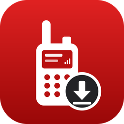
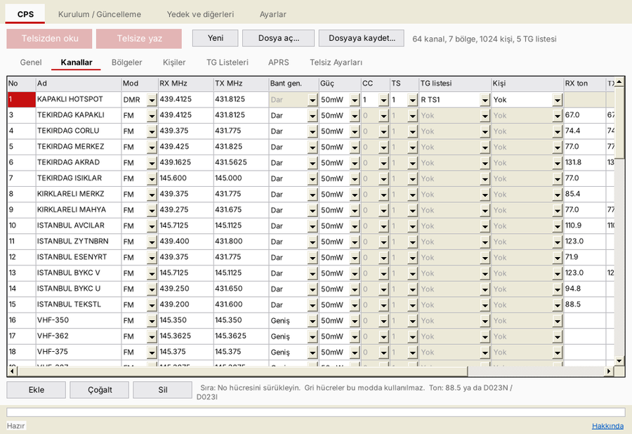

<h1 align="center">TA390</h1>

TYT MD-UV380 / MD-UV390 için OpenGD77 tabanlı, <b>resmi olmayan</b> DMR / FM telsiz yazılımı, 
Windows yükleme ve kod planı (CPS) programı ve Android uygulaması.

<a href="#i̇ndirme"><b>⬇ İndir (v1.3)</b></a> ·
<a href="docs/TA390_v1.3_Kullanim_Kilavuzu.pdf">Kullanım kılavuzu</a> ·
<a href="README.en.md">English</a>

---

## İndirme

Dosya adına tıklayınca indirme başlar. Bütün dosyalar [indir/v1.3](indir/v1.3) ve [docs](docs) klasörlerindedir; dosya özetleri: [SHA256SUMS.txt](indir/v1.3/SHA256SUMS.txt).

| Dosya | Ne işe yarar |
|---|---|
| [`TA390_v1.3.zip`](https://github.com/TB1YZC-Lab/TA390/raw/main/indir/v1.3/TA390_v1.3.zip) | Telsiz yazılımı (`TA390_v1.3.bin`), dil dosyaları, BENIOKU, lisanslar |
| [`TA390_Kurulum_v1.3.exe`](https://github.com/TB1YZC-Lab/TA390/raw/main/indir/v1.3/TA390_Kurulum_v1.3.exe) | Windows programı: yazılım yükleme / güncelleme, yedek, CPS |
| [`TA390_v1.3.apk`](https://github.com/TB1YZC-Lab/TA390/raw/main/indir/v1.3/TA390_v1.3.apk) | Android uygulaması: Windows programıyla aynı işlevler (USB OTG kablosuyla) |
| [`TA390_v1.3_Kullanim_Kilavuzu.pdf`](docs/TA390_v1.3_Kullanim_Kilavuzu.pdf) | Türkçe kullanım kılavuzu |
| [`TA390_v1.3_User_Manual_EN.pdf`](docs/TA390_v1.3_User_Manual_EN.pdf) | İngilizce kullanım kılavuzu |

Telsiz yazılımı, Windows programı ve Android uygulaması her zaman **aynı sürüm numarasını** taşır.

## Özellikler

- **Çift Takip:** bölgedeki iki kayıtlı kanal alt alta görünür ve birlikte dinlenir (orijinal TYT yazılımındaki gibi).
- **Türkçe menüler** (yüklerken Türkçe ya da İngilizce seçilir), telsizde okunabilen **kısayol listesi**.
- **Kayıtlar:** gelen DMR ve FM çağrıları tarih, saat, süre ve kanalla saklanır.
- **APRS:** konum açık kanaldan bağımsız gönderilir, telsizden **APRS mesajı** gönderilebilir, DMR TA.
- **VFO:** adımlı / aralık / FM-DMR taraması, ton ve renk kodu bulma, frekansı kanal olarak kaydetme, sinyal gücü (S / dBm).
- **Kanal Ayrıntısı:** TG listesindeki konuşma grupları döner düğmeyle seçilir.
- **Ekran koruyucu** (saat, tarih, pil), cevapsız çağrı ve hoparlör simgeleri, oyunlar (Yılan, Tetris, Mayın Tarlası).
- **Windows ve Android:** yazılım yükleme / güncelleme, Flash / MCU ROM / kalibrasyon yedeği, boot resmi, uydu bilgileri, sürükle-bırak destekli CPS.

## Kısaca kurulum

1. **Önce yedek alın:** TA390 programında *Yedek ve diğerleri* › Flash, MCU ROM ve Kalibrasyon.
2. Telsizi kapatın, **PTT ile üstündeki tuşu** basılı tutarak açın (LED kırmızı / yeşil yanıp söner), USB kablosunu takın.
3. *Kurulum / Güncelleme* sekmesinde `TA390_v1.3.zip` dosyasını seçin, telsiz dilini seçin, **Yükle**'ye basın.

Ayrıntılar kullanım kılavuzundadır.

### DMR sesi (donör dosya)

DMR ses çözücüsü (AMBE) telif ve patent korumalıdır, **bu projede dağıtılmaz**. İlk kurulumda program, OpenGD77 kurulum rehberinde verilen
bağlantıdan orijinal TYT **MD-9600 v26.45** yazılımını (donör) kullanıcının kendi bilgisayarına / telefonuna indirir ve sesi oradan ekler.
Donör dosyanızı başkalarına dağıtmayın.

### Bilinmesi gerekenler

- Windows kurulumu ve APK ticari bir imza taşımaz: Windows'ta **SmartScreen** uyarısı (“Ek bilgi › Yine de çalıştır”), Android'de
  **bilinmeyen kaynaklardan yükleme** izni görülebilir. Dosyaları sadece bu sayfadan indirin.
- Android uygulaması için **USB OTG** destekleyen bir telefon ve OTG kablosu / adaptörü gerekir.
- Yazılım yükleme kalibrasyonu silmez, ama yine de yüklemeden önce yedek alın.

## Sorun bildirme

Hata ve önerileri [Issues](https://github.com/TB1YZC-Lab/TA390/issues) bölümüne yazın.
**TA390 ile ilgili sorunlar için OpenGD77 ekibine ya da forumuna başvurmayın**; TA390 onlar tarafından hazırlanmamıştır.

## Lisans ve önemli uyarılar

- TA390, [OpenGD77](https://www.opengd77.com) açık kaynak yazılımından türetilmiştir ve **resmi bir OpenGD77 sürümü değildir**.
  OpenGD77 geliştiricileri tarafından hazırlanmamış, onaylanmamış ve desteklenmemektedir.
- **Ücretsizdir. Ticari amaçla kullanılamaz**, satılamaz, ücretli bir ürünün parçası yapılamaz (OpenGD77 lisansı, madde 4).
- **Hiçbir garanti verilmez.** Yükleme ve kullanım tamamen kullanıcının sorumluluğundadır.
- Amatör telsiz yazılımıdır; telsizinizi yalnızca yetkiniz olan frekans ve güçlerde kullanın.

Lisans metni: [LICENSE](LICENSE). Kullanılan bileşenlerin lisansları: [LISANSLAR](LISANSLAR).

## Emeği geçenler

OpenGD77: Kai DG4KLU (ilk tasarım), Roger Clark VK3KYY, Daniel Caujolle-Bert F1RMB, Alex DL4LEX, Colin G4EML ve diğer OpenGD77
geliştiricileri. Yükleme yöntemi ve kodlama tabloları OpenGD77 STM32 firmware loader'dan uyarlanmıştır.
FreeRTOS (MIT), STMicroelectronics STM32 HAL ve USB Device Library, Arm CMSIS (Apache-2.0), libusb (LGPL-2.1),
APRS simgeleri: aprs.fi simge seti (OH7LZB), marka logoları çıkarılmıştır.

TA390: **TB1YZC**
